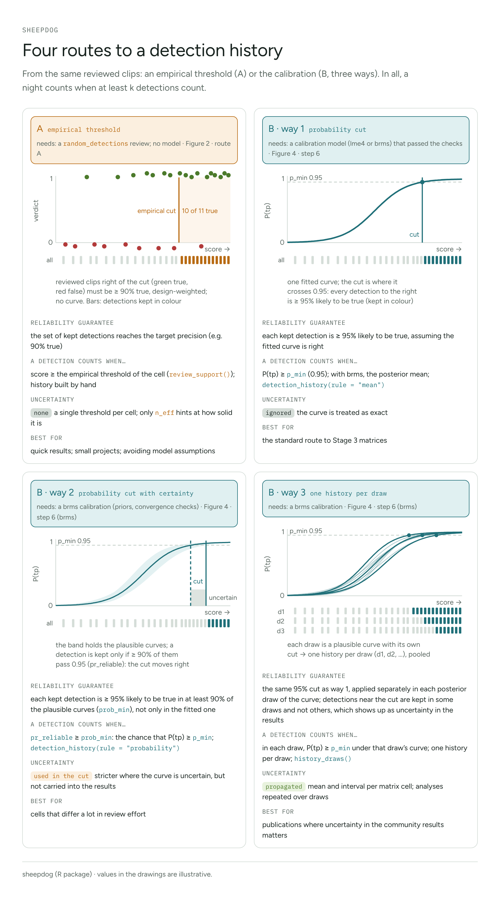

```{r, include = FALSE}
knitr::opts_chunk$set(collapse = TRUE, comment = "#>", eval = FALSE)
```

Once the clips are reviewed, every analysis has to decide which detections
count. sheepdog offers four routes to that decision, and one more step
for occupancy models with false positives. They start from the same
reviewed clips but differ in what they guarantee, in what they need and in
what they do with uncertainty. This article puts them side by side; the
details of each are in `vignette("calibration")`,
`vignette("bayesian-calibration")`, `vignette("community-matrices")` and
`vignette("crywolf-integration")`.

In every route a night counts as detected when at least k of its
detections count (k = 1, 2 or 3).

## Start here

| if you want… | take | needs |
|---|---|---|
| matrices quickly, without a model | **A** · empirical threshold | a `random_detections` review |
| the standard input to Stage 3 | **B · way 1** · probability cut | a calibration (lme4 or brms) that passed its checks |
| caution where review was thin | **B · way 2** · probability cut with certainty | a brms calibration |
| calibration uncertainty in the results | **B · way 3** · one history per draw | a brms calibration |
| occupancy with false positives | the threshold route or the draws route (below) | a random validation design |

## Four routes to a detection history



**A · empirical threshold.** `review_support()` runs `suggest_thresholds()`
on the reviewed clips of each site x species cell and returns the lowest
score at which the clips above it reach the target precision (0.90),
weighted by the sampling design, with its diagnosis (Figure 2 of the
reference index, route A). There is no model: the threshold is read off
the clips. The guarantee is for the **set** of detections kept, not for
each one.

**B · way 1 · probability cut.** The Stage 2 calibration gives every
detection a probability of being true, P(tp); a detection counts when
P(tp) ≥ `p_min` (0.95). This is `detection_history(rule = "mean")` and
what `calibrate()` writes. The guarantee is per detection, and cells with
few reviewed clips borrow strength from the others, but the curve is
treated as exact.

**B · way 2 · probability cut with certainty.** With a brms calibration,
each detection has a posterior for P(tp). `pr_reliable` is the posterior
probability that P(tp) ≥ `p_min`, and a detection counts when
`pr_reliable` ≥ `prob_min` (0.9): `detection_history(rule = "probability")`.
The cut is stricter where the curve is uncertain, typically in cells with
few reviewed clips, but the result is still one history.

**B · way 3 · one history per draw.** `history_draws()` applies the way 1
rule in each posterior draw of the curve and returns one history per
draw. Detections near the cut are kept in some draws and not in others,
and `community_matrices_draws()` turns that into a mean and an interval
for each cell of the matrices.

## Points of caution

**A**

- The 90% holds for the set of detections kept: those just above the cut
  can be mostly false.
- The threshold is the first cut that passes; precision can dip again above
  it.
- Only cells whose diagnosis is "reached" get a threshold.
- The precision is weighted by `inclusion_prob`, which must be right,
  cumulatively over review rounds.
- One cut per cell assumes that precision is stable across the months and
  sites inside it (unless `by` is used).
- There is no built-in function for the history (see the code below).

**B · way 1**

- It depends on the model being right: use only species marked "ok" by
  `calibration_quality()` (Figure 4, step 3).
- The reviewed clips must be a random draw of the detections
  (`random_detections`).
- Partial pooling can lend a weak cell the curve of the others, and outside
  the reviewed scores the curve is extrapolated.
- A site effect in the curve mixes local calling rate into P(tp).
- The classifier must be the same version as the one that produced the
  reviewed clips.

**B · way 2**

- All the cautions of way 1.
- The priors matter where review was thin (`calibration_sensitivity()`).
- `prob_min` is a second choice to justify.
- Dropping detections near the cut means more false negatives.

**B · way 3**

- All the cautions of way 1: a wrong model gives confident wrong draws.
- The intervals cover calibration uncertainty only, not the sampling of
  nights.
- Every analysis has to be repeated over draws and pooled.

## Checking one route against the other

A and B can be compared on the same cells. `calibrated_thresholds()` with
`rule = "precision"` asks the question of A (the precision of the
detections kept) from the model, so the two thresholds should agree when
the model reproduces what the reviewed clips show:

```{r}
thr_A <- review_support(val_clips, pred, target_precision = 0.90) |>
  filter(diagnosis == "reached")
thr_B <- calibrated_thresholds(res$fit, target = 0.90, rule = "precision",
                               scored = res$scored)
```

If they agree, report the model-based route. Where they differ, look at the
cell: a model threshold far below the empirical one can mean that pooling
lends the cell a curve; an empirical threshold far below can mean that the
first passing cut was lucky.

Note that B with `rule = "probability"` and a target of 0.95 asks a
stricter question (each detection, not the set), so its thresholds are
usually higher than those of A at 0.90.

## Occupancy with false positives

Occupancy models with false positives, such as those of
[crywolf](https://github.com/diogoprov/crywolf), estimate the false-positive
rate themselves from a subset of known truth. Any route can feed them:

- **Threshold route** (A, or B with lme4 or brms): the score threshold
  becomes the detection rule. Export with `export_occupancy_data()`
  without `fit`; in crywolf, `fp_aggregate(threshold = )` builds the
  occasions and one model is fitted.
- **Draws route** (B with brms only): `export_occupancy_data(fit = )`
  writes the calibration draws, and `occasion_draws()` (or
  `crywolf::fp_draws_data()`) builds one detection matrix per draw. The
  model is fitted to each and the posteriors pooled
  (`crywolf::fp_occu_mc()`), so the uncertainty of the calibration reaches
  occupancy.

Both need known truth drawn at random (`vignette("sampling-designs")`):

- `random_detections` at **the same threshold** as the occupancy analysis
  (the observation-confirmation design), which anchors the false-positive
  rate; and/or
- `random_recordings` (the multiple-methods design), which anchors the
  state of sites and shows what the classifier misses.

Use a calibration without a site effect for occupancy: P(tp | score, site)
partly reflects how often the species calls at the site, which is what
occupancy estimates, so it would be counted twice.

## Code per route

The objects below follow `vignette("calibration")`: `val_files` are the
`validation_by_clip.csv` tables, `tables` the selection tables by site and
`pred` the predictions read with `read_selection_tables()`.

**A · empirical threshold.** There is no function that turns the
thresholds of `review_support()` into a nightly history; it is built by
hand from the predictions, with the night of each one (the date of the
recording, moved back a day before `dawn_hour`):

```{r}
val_clips <- read_validation_tables(val_files)
thr_A <- review_support(val_clips, pred, target_precision = 0.90) |>
  filter(diagnosis == "reached") |>
  select(site, species_folder, threshold)

history_A <- pred |>
  # species_folder and night must be added to pred to match thr_A
  inner_join(thr_A, by = c("site", "species_folder")) |>
  group_by(site, species = species_folder, night) |>
  summarise(n_reliable = sum(confidence >= threshold), .groups = "drop") |>
  mutate(detection_k1 = n_reliable >= 1, detection_k2 = n_reliable >= 2,
         detection_k3 = n_reliable >= 3)
```

**B · way 1.**

```{r}
res <- calibrate(validation_files = val_files, prediction_tables = tables,
                 output_dir = "calibration", p_min = 0.95)
history_1 <- res$history                     # also nightly_detection_history.csv
```

**B · ways 2 and 3** (brms; see `vignette("bayesian-calibration")` for the
prior and the checks):

```{r}
res_b <- calibrate(validation_files = val_files, prediction_tables = tables,
                   output_dir = "calibration_brms", engine = "brms",
                   prior = my_prior, p_min = 0.95)   # calibration_prior(), checked first
history_2 <- detection_history(res_b$scored, p_min = 0.95,
                               rule = "probability", prob_min = 0.9)
history_3 <- history_draws(res_b$fit, res_b$scored, p_min = 0.95, n_draws = 200)
```

**Then, for the community matrices** (B; `vignette("community-matrices")`):

```{r}
status <- cell_status(res$fit, read_validations(val_files), p_min = 0.95)
core   <- suggest_core_species(status)            # species codes; the final choice is yours
mats   <- community_matrices(history_1, core_species = core)
mats_3 <- community_matrices_draws(history_3, core_species = core)
```

**Or, for occupancy** (`vignette("crywolf-integration")`):

```{r}
# threshold route
export_occupancy_data("occupancy", detections = pred, validation = val_clips)
# draws route
export_occupancy_data("occupancy_draws", detections = pred,
                      validation = val_clips, fit = res_b$fit)
occasion_draws("occupancy_draws", rule = "sample")
```

## See also

- Figures 2 and 4 of the [reference index](../reference/index.html): the
  empirical and model-based thresholds, and Stage 2 step by step.
- `vignette("calibration")`: thresholds from the calibration and the
  nightly history.
- `vignette("bayesian-calibration")`: the two rules for a reliable
  detection, and the propagation of uncertainty.
- `vignette("community-matrices")`: the entry rule, the core species and
  the analyses.
- `vignette("sampling-designs")` and `vignette("crywolf-integration")`:
  the validation designs and the occupancy export.
